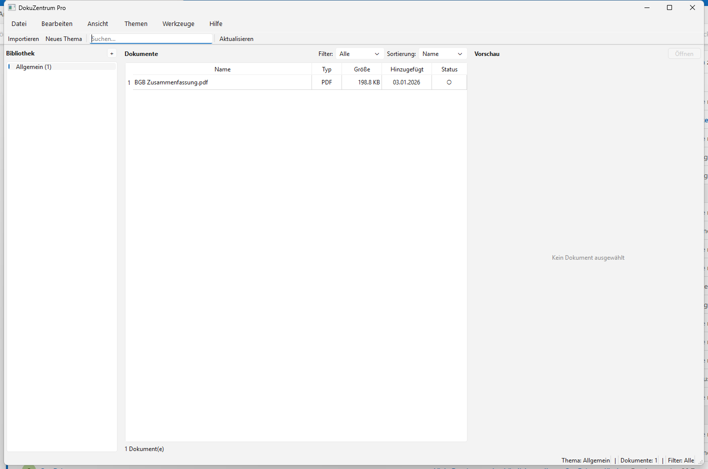
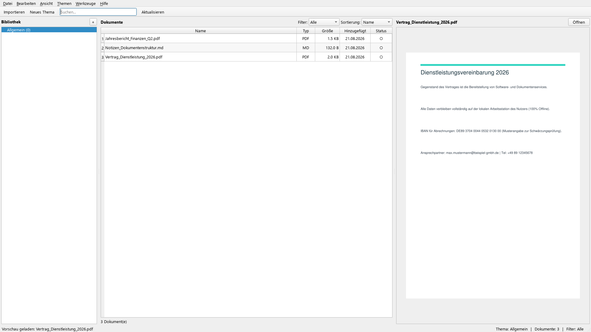
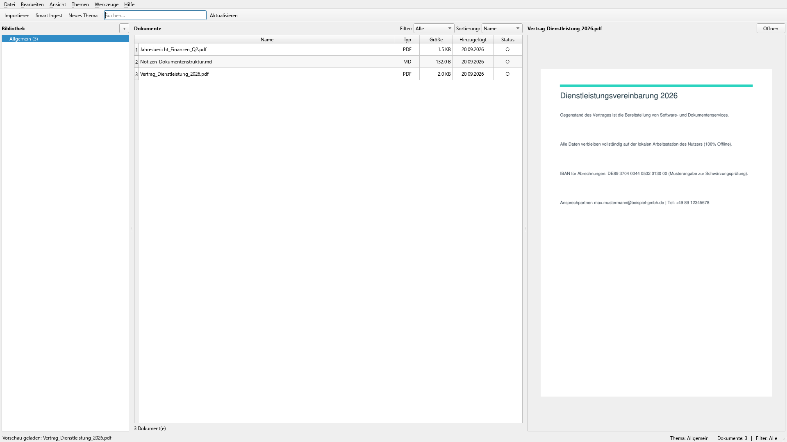
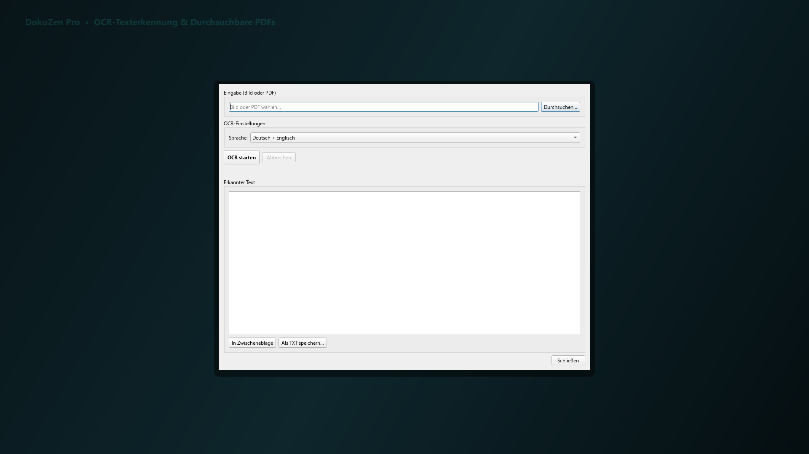
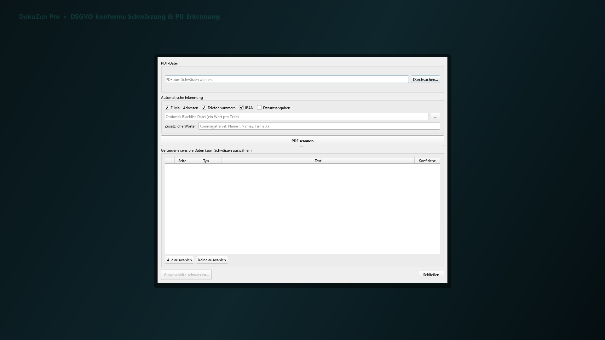
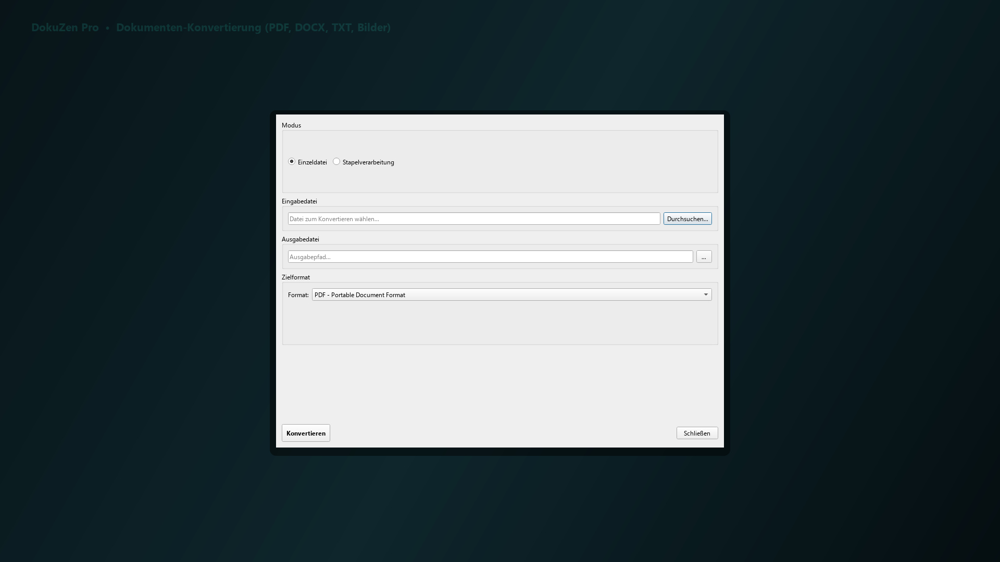
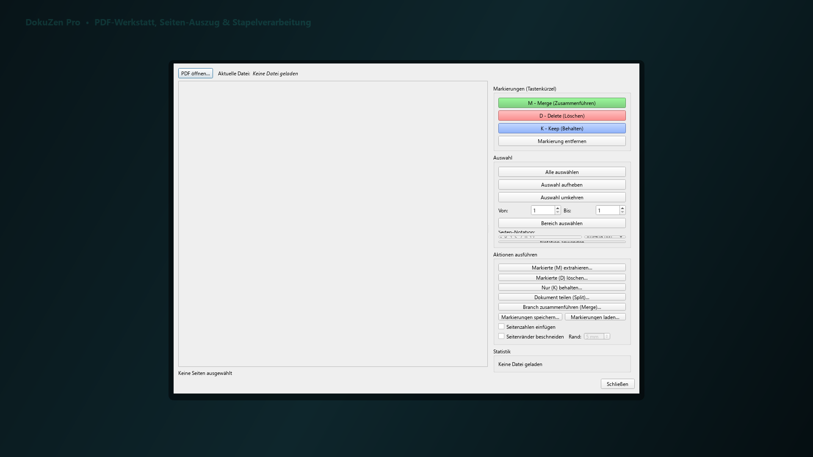
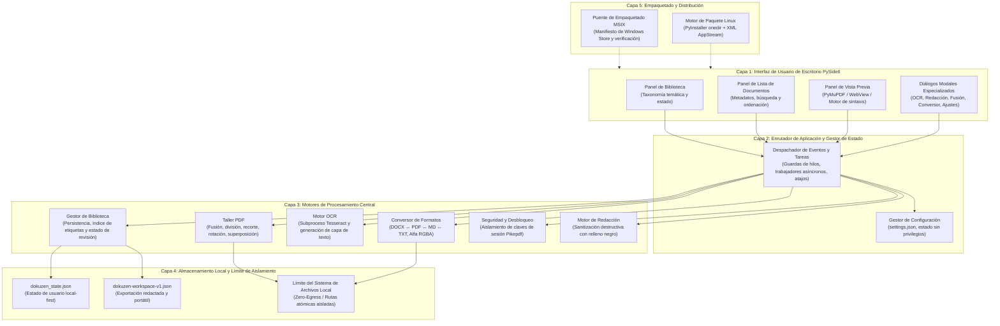
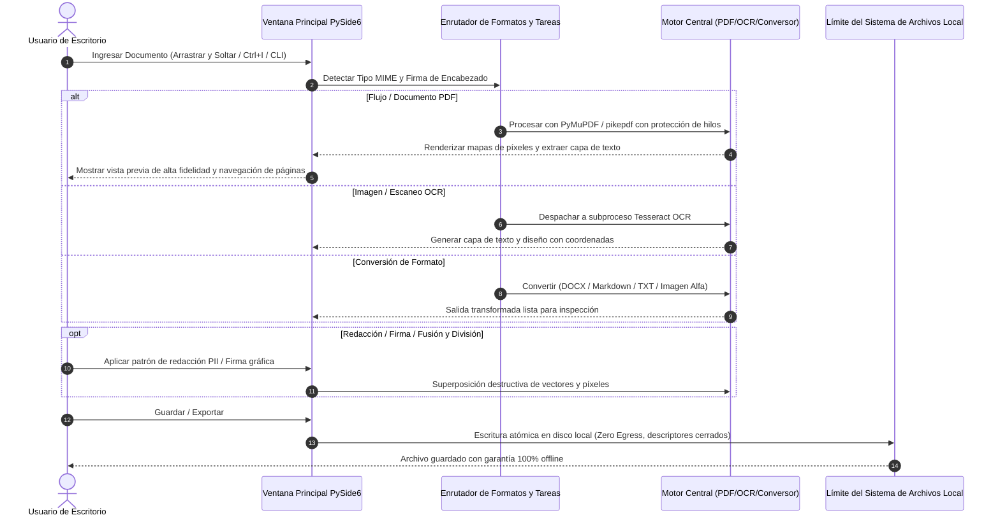

# DokuZen

[English](README.md) · [Deutsch](README_de.md) · **Español**

[](https://github.com/doc-bricks/DokuZen/actions/workflows/source-platform-smoke.yml)
[](https://docs.pytest.org/)
[](https://www.python.org/)
[](https://github.com/doc-bricks/DokuZen)
[](SECURITY.md)
[](SECURITY.md)
[](pyproject.toml)
[](LICENSE)
[](NOTICE)
[](https://github.com/doc-bricks)
[](https://github.com/open-bricks)
[](llms.txt)
[](THIRD_PARTY_LICENSES.txt)
[](MARKETING-LOG.txt)
[](MARKETING-LOG.txt)

> [!NOTE]
> **Índice de integración para IA / LLM:** El contexto legible por máquina, los límites de API y los contratos de arquitectura del repositorio están indexados en [`llms.txt`](llms.txt).

**DokuZen** es una suite de escritorio multiplataforma y local-first para la gestión y procesamiento de documentos desarrollada con Python y PySide6, que combina **22 utilidades especializadas de texto, PDF, OCR y archivos** en un único espacio de trabajo unificado.

---

## 🧭 Navegación Rápida

- 📸 [Galería Visual y Demostración](#visual-showcase)
- 🏛️ [Arquitectura del Sistema](#architecture)
- 🔄 [Ciclo de Vida y Procesamiento de Documentos](#lifecycle)
- ✨ [Características Principales y 22 Utilidades](#core-features)
- 🎯 [Perfiles de Usuario y Casos de Uso](#target-personas)
- ⚖️ [Matriz Comparativa frente a 5 Alternativas](#comparative-matrix)
- 🚀 [Instalación y Guía Rápida](#installation)
- 🖥️ [Puntos de Entrada GUI-CLI y Automatización Headless](#cli-entry-points)
- 🌐 [Ecosistema y Herramientas Hermanas](#ecosystem)
- 🔒 [Invariantes de Privacidad y Seguridad](#privacy-security)
- 🧪 [Pruebas y Verificación](#verification-testing)
- ⌨️ [Atajos de Teclado](#keyboard-shortcuts)
- 🪟 [Empaquetado Windows Store y MSIX](#windows-store)
- 🐧 [Paquete Portable Linux](#linux-bundle)
- 📦 [Exportación de Espacio de Trabajo Offline y PWA Móvil](#workspace-export)
- 📜 [Registro de Auditoría y Descubrimiento](#audit-transparency)
- ⚖️ [Aviso Legal y Exención de Responsabilidad (§ 521 BGB)](#statutory-notice)
- 📄 [Licencia y Dependencias de Terceros](#license-third-party)

---

<a id="visual-showcase"></a>
## 📸 Galería Visual y Demostración

| Vista General | Vista en Detalle |
|:---:|:---:|
| <br/><sub>**Interfaz Principal de DokuZen** — Espacio de trabajo de 3 paneles con taxonomía de biblioteca, lista de documentos y vista previa de alta fidelidad.</sub> | <br/><sub>**Biblioteca de Documentos** — Categorización temática, filtrado por etiquetas y seguimiento de lectura en colecciones de documentos.</sub> |
| <br/><sub>**Vista Previa PDF de Alta Velocidad** — Navegación multipágina, zoom continuo y renderizado fuera de pantalla nativo con PyMuPDF.</sub> | <br/><sub>**OCR y Extracción de Diseño** — Conversión de imágenes escaneadas a PDF con búsqueda y detección automática de idioma.</sub> |
| <br/><sub>**Redacción Permanente** — Sanitización irreversible de datos sensibles (PII) mediante relleno negro vectorial y limpieza de flujos.</sub> | <br/><sub>**Conversor de Formatos** — Bidireccional DOCX ↔ PDF ↔ Markdown ↔ TXT con preservación de transparencia alfa RGBA.</sub> |
| <br/><sub>**Operaciones por Lotes y Fusión** — Fusión de múltiples archivos, división, sellos y superposición de firmas.</sub> | *(Capturas de pantalla generadas en resolución nativa de 1080p)* |

---

<a id="architecture"></a>
## 🏛️ Arquitectura del Sistema



---

<a id="lifecycle"></a>
## 🔄 Ciclo de Vida y Procesamiento de Documentos



---

<a id="core-features"></a>
## ✨ Características Principales y 22 Utilidades

### 📚 Biblioteca de Documentos
- **Organización Temática**: Categorice documentos por temas y etiquetas con selección persistente entre reinicios.
- **Estado de Lectura / No Leído**: Controle el progreso de revisión en grandes colecciones documentales.
- **Búsqueda y Filtrado Rápido**: Filtro instantáneo por nombre, contenido y metadatos con el atajo global `Ctrl+F`.
- **Importación por Arrastrar y Soltar**: Ingesta directa de archivos en las categorías activas con reconocimiento automático de formato.

### 📄 Taller PDF
- **Fusión y División**: Combine múltiples flujos de PDF o divídalos en rangos de páginas específicos.
- **Integración con Tesseract OCR**: Genere archivos PDF con capacidad de búsqueda y extraiga capas de texto con precisión.
- **Sanitización y Redacción**: Redacción de datos confidenciales (PII) basada en expresiones regulares y selección de tramos con relleno negro destructivo.
- **Superposición de Firma y Sellos**: Estampe firmas transparentes en PNG o distintivos de metadatos en las páginas seleccionadas.
- **Eliminación de Contraseña**: Desbloquee archivos protegidos con contraseña mediante `pikepdf` con protección de claves de sesión.
- **Transformación de Páginas**: Rotación no destructiva y destructiva, recorte de márgenes y reordenación de páginas.

### 🔄 Conversor Multiformato
- **Word ↔ PDF ↔ Markdown ↔ Texto Plano**: Transiciones fluidas y bidireccionales entre formatos de documentos.
- **Conversión de Imágenes**: PNG, JPG, ICO, WebP con preservación completa de transparencia alfa RGBA al convertir a PDF.
- **Reparación de Codificación**: Corrección automática de caracteres dañados (Mojibake) y restauración UTF-8 / Latin-1.

### 🛠️ Herramientas de Desarrollo y Productividad
- **Compilador de Python a EXE**: Interfaz de empaquetado PyInstaller con incrustación de iconos y detección de dependencias.
- **Generador de Licencias**: Creación estandarizada de licencias de código abierto.
- **Divisor de Código**: Separación limpia de archivos fuente Python con múltiples clases en unidades modulares.
- **Web Companion y Exportación de Espacio de Trabajo**: Exporte instantáneas de espacios de trabajo redactadas `dokuzen-workspace-v1.json` para visores PWA móviles.

### 🔒 Servicios en Segundo Plano y Empaquetado
- **Monitor de Privacidad**: Supervisión visual que alerta sobre la exposición de datos confidenciales.
- **Motor de Sincronización**: Asistente de sincronización local-first.
- **Media Brain**: Extracción e indexación integrada de recursos multimedia.
- **Puente para Windows Store**: Manifiesto de empaquetado MSIX y comprobaciones automáticas de preparación para publicación.

---

<a id="target-personas"></a>
## 🎯 Perfiles de Usuario y Casos de Uso

DokuZen está diseñado para profesionales y usuarios avanzados que requieren herramientas locales de confianza:

### `[PERSONA-01]` Auditores de Privacidad Corporativa y Cumplimiento Legal
- **Marcos Regulatorios:** RGPD (DSGVO), HIPAA, CCPA, ISO 27001, SOC 2.
- **Punto de Dolor:** Los conversores web en la nube (Smallpdf, iLovePDF) suben contratos confidenciales y datos de pacientes a servidores externos de terceros, violando la residencia de datos y el secreto profesional.
- **Solución DokuZen:** Ejecución 100% local sin salida de datos (Zero-Egress), sanitización destructiva con relleno negro vectorial, ejecución sin privilegios (`RunAsInvoker`) y cierre garantizado de descriptores de archivos.
- **Consultas de Búsqueda Clave:**
  - `herramienta local redaccion pdf cumplimiento rgpd`
  - `sanitizador offline pii en pdf`
  - `anonimizador documentos escritorio sin salida datos`
  - `software seguro redaccion documentos legales`

### `[PERSONA-02]` Usuarios Avanzados de Escritorio, Asistentes Jurídicos y Profesionales de Oficina
- **Contexto:** Profesionales que gestionan grandes volúmenes diarios de facturas, contratos, formularios e informes de clientes.
- **Punto de Dolor:** Costosas suscripciones anuales a Adobe Acrobat Pro (+240 €/año), lentitud de inicio de la aplicación, actualizadores invasivos en segundo plano y fragmentación de utilidades.
- **Solución DokuZen:** Suite completa de 22 utilidades en un solo ejecutable de escritorio, previsualización ultrarrápida PyMuPDF, atajos de teclado (`Ctrl+I`, `Ctrl+F`, `Ctrl+P`), fusión por lotes y estampación de firmas con transparencia.
- **Consultas de Búsqueda Clave:**
  - `alternativa gratuita adobe acrobat pro offline`
  - `fusionar y dividir pdf escritorio rapido`
  - `gestor documental pyside6`
  - `herramienta escritorio firma pdf transparente`

### `[PERSONA-03]` Investigadores de Código Abierto, Archiveros y Académicos
- **Contexto:** Científicos, historiadores y archiveros digitales que catalogan extensas colecciones documentales y escaneos históricos.
- **Punto de Dolor:** Ausencia de capas OCR en documentos escaneados, falta de categorización temática, corrupción de codificación (Mojibake) y dependencia de formatos propietarios.
- **Solución DokuZen:** Motor Tesseract OCR con detección automática de idioma, clasificación temática con control de lectura, reparación de Mojibake y exportación limpia a Markdown y texto plano.
- **Consultas de Búsqueda Clave:**
  - `herramienta busqueda ocr pdf codigo abierto`
  - `organizador documentos academicos local first`
  - `tesseract ocr gui python escritorio`
  - `escanear a pdf con busqueda offline`

### `[PERSONA-04]` Ingenieros de Automatización e Integradores de Ecosistemas
- **Contexto:** Ingenieros de Python, administradores de sistemas y profesionales DevOps que gestionan canalizaciones locales de procesamiento de documentos.
- **Punto de Dolor:** APIs REST en la nube inestables, dependencia de plataforma propietaria, fugas de archivos temporales y dependencias complejas.
- **Solución DokuZen:** Doble vía de distribución (MSIX para Windows Store + paquete Linux con PyInstaller), atajos CLI directos (`--import`, `--ocr`, `--redact`, `--merge`), esquema abierto `dokuzen-workspace-v1.json` y verificación continua en CI.
- **Consultas de Búsqueda Clave:**
  - `paquete portable herramientas pdf linux`
  - `automatizacion pdf python local first`
  - `aplicacion escritorio python msix`
  - `flujo trabajo documental offline reproducible`

---

<a id="comparative-matrix"></a>
## ⚖️ Matriz Comparativa frente a 5 Alternativas

| Invariante / Característica | DokuZen 1.0.1 | Adobe Acrobat Pro | Smallpdf / iLovePDF | PDF24 Creator | Master PDF Editor | Okular / Evince |
|---|:---:|:---:|:---:|:---:|:---:|:---:|
| **INV-LOCAL-01: Privacidad Zero-Egress** | ✅ **100% Local** | ⚠️ Sincronización Nube | ❌ Subida a Nube | ✅ Nativo Local | ✅ Nativo Local | ✅ Nativo Local |
| **INV-COST-02: Código Abierto / Precio** | ✅ **Gratis (AGPL-3.0)** | ❌ +240 €/año suscripción | ❌ +108 €/año suscripción | ⚠️ Freeware (Propietario) | ❌ +70 € Comercial | ✅ Gratis (GPL) |
| **INV-PRIV-03: Redacción Destructiva** | ✅ **Relleno Vectorial** | ✅ Sí | ❌ Riesgo Servidor | ⚠️ Básico | ⚠️ Parcial | ❌ No disponible |
| **INV-TOOL-04: Consolidación de Herramientas** | ✅ **22 Utilidades** | ⚠️ Suite pesada | ⚠️ Herramientas separadas | ⚠️ 15 Utilidades | ⚠️ Solo PDF limitado | ❌ Solo Visor |
| **INV-OCR-05: Capa OCR Tesseract** | ✅ **Integrado Nativo** | ⚠️ OCR Propietario | ❌ Cola en la nube | ✅ OCR Básico | ❌ Solo con Licencia de Pago | ⚠️ Mediante Plugin |
| **INV-PERF-06: Renderizado Rápido** | ✅ **PyMuPDF / Fitz** | ✅ C++ Nativo | ❌ Latencia Navegador | ⚠️ Ghostscript | ✅ C++ Nativo | ✅ Poppler |
| **INV-PLAT-07: Paridad Multiplataforma** | ✅ **Win / Linux / Mac** | ⚠️ Solo Win / Mac | ⚠️ Solo Navegador | ❌ Solo Windows | ⚠️ Linux / Windows | ⚠️ Nativo Linux |
| **INV-FMT-08: Conversor Multiformato** | ✅ **Bidireccional** | ⚠️ Propietario | ⚠️ Render en Servidor | ⚠️ Básico | ❌ Solo PDF | ❌ Solo Exportación |
| **INV-SECR-09: Entorno sin Privilegios** | ✅ **RunAsInvoker** | ❌ Demonios en Fondo | ❌ Multitenant Remoto | ⚠️ Servicios Fondo | ✅ Usuario Estándar | ✅ Usuario Estándar |
| **INV-ARCH-10: Exportación Abierta** | ✅ **dokuzen-json v1** | ❌ Bloqueo en Nube | ❌ Bloqueo en Cuenta | ❌ Ninguna | ❌ Ninguna | ❌ Ninguna |

---

<a id="installation"></a>
## 🚀 Instalación y Guía Rápida

### Requisitos
- Python 3.10, 3.11, 3.12 o 3.13
- PySide6 >= 6.5.0
- Tesseract OCR (opcional, para funciones de reconocimiento óptico de texto)
- Dependencias indicadas en `requirements.txt` / `pyproject.toml`

### Instalación

```bash
# Clonar el repositorio
git clone https://github.com/doc-bricks/DokuZen.git
cd DokuZen

# Crear el entorno virtual
python -m venv venv
venv\Scripts\activate  # Windows
source venv/bin/activate  # Linux/macOS

# Instalar dependencias
pip install -r requirements.txt

# Iniciar DokuZen
python main.py
```

*Nota: En Windows también puede iniciarse directamente mediante `start.bat`.*

---

<a id="cli-entry-points"></a>
## 🖥️ Puntos de Entrada GUI-CLI y Automatización Headless

DokuZen proporciona parámetros de línea de comandos que inician la aplicación de escritorio y navegan de inmediato al flujo de trabajo deseado, así como un modo por lotes headless (`--headless` o `--batch`) para flujos desatendidos en servidores, scripts y agentes sin requerir servidor gráfico ni bucle de eventos Qt:

### Atajos de Inicio Directo en GUI
```bash
# Importar documentos directamente a la biblioteca
python main.py --import document.pdf notes.md

# Abrir documento de inmediato en el panel de vista previa
python main.py --open manual.pdf

# Iniciar diálogo de OCR con archivo precargado
python main.py --ocr scan.pdf

# Iniciar diálogo de redacción de datos sensibles
python main.py --redact contract.pdf

# Iniciar diálogo de fusión de PDF
python main.py --merge part1.pdf part2.pdf
```

### CLI Headless por Lotes (Automatización e Integración con Agentes)
```bash
# Fusión headless de PDF (múltiples archivos)
python main.py --headless --merge a.pdf b.pdf -o merged.pdf

# OCR headless a PDF con búsqueda o extracción de texto plano
python main.py --headless --ocr scan.pdf -o output.pdf --lang spa
python main.py --headless --ocr scan.pdf --ocr-format text -o extracted.txt

# Redacción headless con detección PII y lista negra personalizada
python main.py --headless --redact contract.pdf -o sanitized.pdf --sensitive-types iban email phone

# Inspección headless de metadatos y páginas de PDF (salida estructurada JSON)
python main.py --headless --info doc.pdf --json
```

> [!NOTE]
> **Límite de Automatización:** DokuZen admite tanto flujos interactivos de escritorio como procesamiento headless mediante `--headless`/`--batch`. Todas las operaciones se adhieren estrictamente a la invariante local-first y zero-egress (`INV-LOCAL-01`). Las APIs REST remotas permanecen intencionadamente no implementadas hasta que se justifiquen casos de uso remotos específicos y modelos de seguridad aprobados.

---

<a id="ecosystem"></a>
## 🌐 Ecosistema y Herramientas Hermanas

DokuZen se mantiene bajo el ecosistema **`doc-bricks`**, integrado en la familia de herramientas locales **`open-bricks`**:

| Repositorio | Propósito | Estado |
|---|---|---|
| [doc-bricks/DokuZen](https://github.com/doc-bricks/DokuZen) | Suite integral para gestión y tratamiento de documentos y PDF | Activo / 1.0.1 |
| [doc-bricks/CleanMarkdown](https://github.com/doc-bricks/CleanMarkdown) | Editor Markdown sin distracciones y exportador de PDF | Activo / 1.0.0 |
| [doc-bricks/FormularErstellen](https://github.com/doc-bricks/FormularErstellen) | Diseñador interactivo de formularios PDF y AcroForm | Activo / 1.5.0 |
| [doc-bricks/UniversalDocsGrabber](https://github.com/doc-bricks/UniversalDocsGrabber) | Descarga automática de documentos IMAP y visor PWA | Activo / 1.1.4 |
| [doc-bricks/PDFtoPDFocr](https://github.com/doc-bricks/PDFtoPDFocr) | Motor de conversión OCR y generación de PDF con búsqueda | Activo / 1.1.3 |
| [doc-bricks/DokuReader](https://github.com/doc-bricks/DokuReader) | Lector ligero multiformato de documentos | Activo / 1.0.0 |
| [doc-bricks/MediaBrain](https://github.com/doc-bricks/MediaBrain) | Extracción e indexación multiformato de recursos multimedia | Activo / 0.1.0 |
| [doc-bricks/TextBrain](https://github.com/doc-bricks/TextBrain) | Análisis y extracción de texto asistido por IA | Activo / 0.1.0 |
| [file-bricks/WinStorePackager](https://github.com/file-bricks/WinStorePackager) | Herramienta de empaquetado MSIX para Windows Store | Activo / 3.1.0 |
| [file-bricks/ProSync](https://github.com/file-bricks/ProSync) | Respaldo local y sincronización protegida con WAL | Activo / 3.2.1 |
| [file-bricks/ExplorerPro](https://github.com/file-bricks/ExplorerPro) | Gestor de archivos local-first con pestañas múltiples | Activo / 1.0.3 |
| [dev-bricks/DevCenter](https://github.com/dev-bricks/DevCenter) | Panel de productividad para desarrolladores | Activo / 1.0.0 |
| [open-bricks/.github](https://github.com/open-bricks/.github) | Organización coordinadora y estándares abiertos | Activo |

---

<a id="privacy-security"></a>
## 🔒 Invariantes de Privacidad y Seguridad

DokuZen está comprometido con la máxima privacidad y seguridad:

- **100% Local-First y Zero-Egress (`INV-LOCAL-01`)**: Todas las operaciones con documentos, conversiones y reconocimientos OCR se ejecutan exclusivamente en su CPU/GPU local. Ningún contenido ni telemetría se transmite a través de la red.
- **Modo de Usuario sin Privilegios (`INV-SECR-09`)**: DokuZen se ejecuta sin privilegios administrativos ni de root (`RunAsInvoker`).
- **Redacción Destructiva (`INV-PRIV-03`)**: Las redacciones se aplican de forma irreversible directamente sobre los flujos vectoriales y mapas de bits, impidiendo la recuperación del texto suprimido.
- **Limpieza Determinista de Archivos**: Todos los archivos temporales intermedios se eliminan atómicamente tras finalizar la operación, garantizando el cierre de los descriptores de archivos.

Las directrices detalladas de seguridad se encuentran en [`SECURITY.md`](SECURITY.md).

---

<a id="verification-testing"></a>
## 🧪 Pruebas y Verificación

DokuZen mantiene una completa suite automatizada de pruebas que valida operaciones unitarias, diálogos gráficos, ciclos de cifrado PDF y paridad de metadatos:

```bash
# Ejecutar la suite completa de pruebas (514 superadas, 100% verde)
python -m pytest

# Ejecutar pruebas de plataforma fuera de pantalla (smoke tests)
python tests/test_source_platform_smoke.py

# Ejecutar el validador de preparación para Windows Store
python tools/check_store_readiness.py

# Validar el contrato del paquete portable Linux (independiente del host)
python tools/build_linux_bundle.py --check

# Ejecutar la comprobación de linters
python -m ruff check .
```

---

<a id="keyboard-shortcuts"></a>
## ⌨️ Atajos de Teclado

| Atajo | Acción |
|---|---|
| `Ctrl+I` | Importar archivos en la categoría activa |
| `Ctrl+N` | Crear nuevo tema / categoría |
| `Ctrl+F` | Enfocar el filtro de búsqueda |
| `Ctrl+P` | Alternar panel de vista previa |
| `Ctrl+,` | Abrir diálogo de preferencias |
| `Ctrl+Shift+E` | Exportar instantánea de espacio de trabajo (`dokuzen-workspace-v1.json`) |
| `F5` | Actualizar índice de documentos |

---

<a id="windows-store"></a>
## 🪟 Empaquetado Windows Store y MSIX

DokuZen incluye la infraestructura completa de empaquetado para Microsoft Windows Store (MSIX):
- **Manifiesto**: `store_package/DokuZen/AppxManifest.xml` (`Geiger.DokuZen`, `runFullTrust`)
- **Recursos**: Capturas en resolución 1080p en `screenshots/store/` e iconos de alta resolución (44x44, 50x50, 150x150, 310x150, 310x310)
- **Validación**: Script automatizado de verificación previa mediante `tools/check_store_readiness.py`

La trazabilidad del empaquetado es explícita: el paquete activo `1.0.1.0` utiliza el nombre de ejecutable consolidado `DokuZen-Pro-1.0.0-win64.exe`. El manifiesto histórico en `store_package/DokuZen Pro/` no forma parte de la entrada activa; las comprobaciones se dirigen directamente a `store_package/DokuZen/AppxManifest.xml`.

---

<a id="linux-bundle"></a>
## 🐧 Paquete Portable Linux

DokuZen cuenta con una vía de empaquetado reproducible basada en PyInstaller (onedir) para Linux. Un flujo dedicado construye `DokuZen-1.0.1-linux-<arquitectura>.tar.gz` que incluye la aplicación, recursos gráficos, catálogo en seis idiomas, configuración, entrada de escritorio Freedesktop, metadatos AppStream, licencia y documentación bilingüe.

```bash
# Verificación de metadatos y contrato en cualquier host
python tools/build_linux_bundle.py --check

# Construcción efectiva del paquete en Linux
python tools/build_linux_bundle.py
```

Tesseract sigue siendo una dependencia externa opcional; DokuZen se inicia sin él, manteniéndose inactivas las funciones OCR hasta que se instale. Consulte [`packaging/linux/README.md`](packaging/linux/README.md) para las instrucciones de extracción y arranque.

---

<a id="workspace-export"></a>
## 📦 Exportación de Espacio de Trabajo Offline y PWA Móvil

DokuZen incorpora una función de exportación (`Ctrl+Shift+E` o **Archivo → Exportar Espacio de Trabajo...**) que genera una instantánea redactada y portable compatible con el esquema `dokuzen-workspace-v1`:

- **Garantía de Redacción Segura**: Se omiten por completo las rutas absolutas del sistema de archivos local, contraseñas y claves de acceso.
- **Estado Categórico Completo**: Preservación íntegra de temas de documentos, etiquetas, estados de lectura y tamaños de archivo en bytes.
- **Listo para Acompañante Móvil**: Diseñado para su carga en visores web progresivos (PWA) offline y archivos estáticos sin necesidad de servidores.

---

<a id="audit-transparency"></a>
## 📜 Registro de Auditoría y Descubrimiento

DokuZen mantiene total transparencia operativa en todas sus publicaciones y auditorías del ecosistema:
- **Registro de Marketing de Ruta B**: Asignación detallada de perfiles de usuario, palabras clave SEO y matrices comparativas en [`MARKETING-LOG.txt`](MARKETING-LOG.txt).
- **Inventario de Dependencias de Terceros**: Clasificación completa de licencias SPDX y delimitación de copyleft en [`THIRD_PARTY_LICENSES.txt`](THIRD_PARTY_LICENSES.txt) y [`THIRD_PARTY_LICENSES.md`](THIRD_PARTY_LICENSES.md).
- **Historial de Versiones**: Registro cronológico de cambios en [`CHANGELOG.md`](CHANGELOG.md).

---

<a id="statutory-notice"></a>
## ⚖️ Aviso Legal y Exención de Responsabilidad (§ 521 BGB)

> [!IMPORTANT]
> **Limitación de responsabilidad por cesión gratuita de software (§ 521 BGB):**
> Dado que este software se proporciona de forma gratuita como software de código abierto, los autores y colaboradores solo responden por dolo o negligencia grave de conformidad con el artículo 521 del Código Civil alemán (Bürgerliches Gesetzbuch - BGB). El software se suministra "tal cual", sin garantía de ningún tipo, expresa o implícita.

---

<a id="license-third-party"></a>
## 📄 Licencia y Dependencias de Terceros

DokuZen se distribuye bajo la licencia **GNU Affero General Public License v3.0 o posterior ([AGPL-3.0-or-later](LICENSE))**. Las menciones de autoría, avisos de copyright y procedencia de código abierto están declaradas en [`NOTICE`](NOTICE).

Las librerías de terceros y los límites de copyleft en tiempo de ejecución están documentados en [`THIRD_PARTY_LICENSES.txt`](THIRD_PARTY_LICENSES.txt) y [`THIRD_PARTY_LICENSES.md`](THIRD_PARTY_LICENSES.md).
